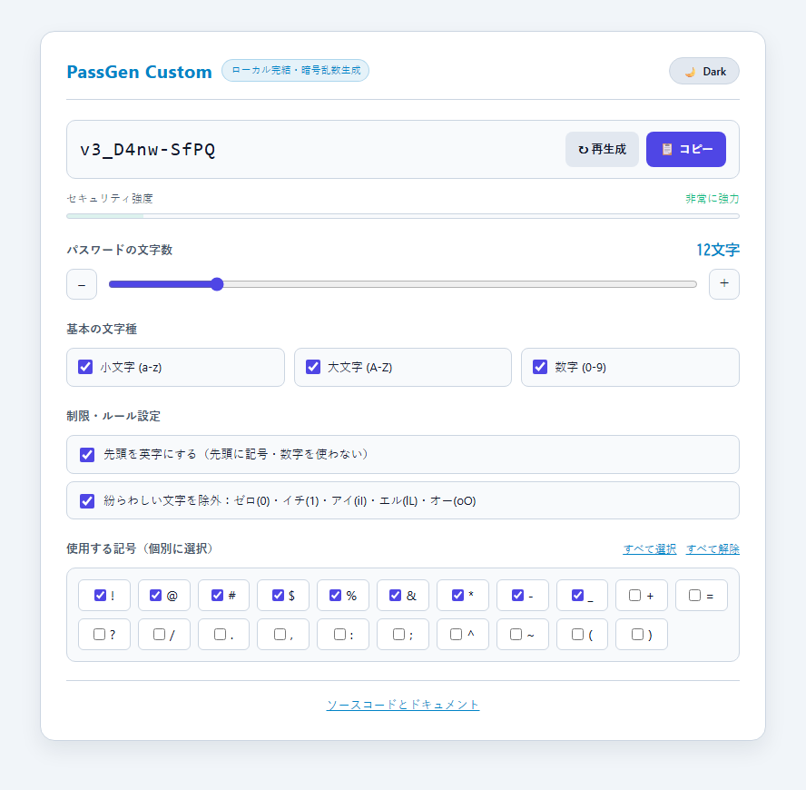
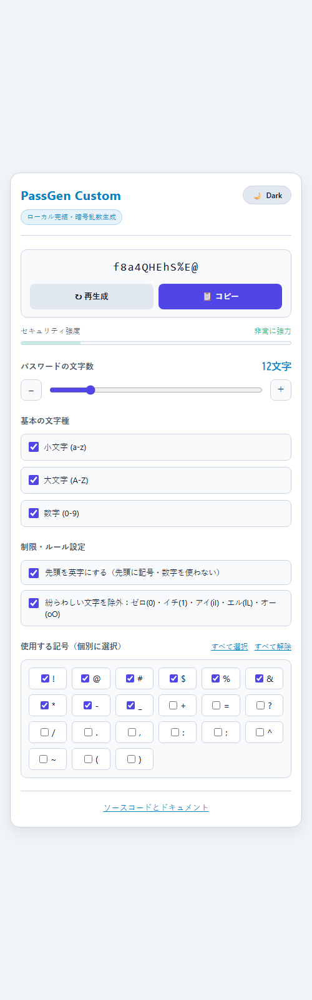

# PassGen Custom

`password_gen_custom.html` だけで動作する、オフライン対応のパスワードジェネレータです。外部ライブラリや通信を使用せず、Webブラウザ内でパスワードを生成します。

単一HTML版に加えて、Chromeのツールバーから同じ画面と機能を利用できるManifest V3拡張機能も生成できます。日本語の単一HTML版が実装の原本であり、英語の単一HTML版と拡張機能版はビルドスクリプトによって生成されます。

## スクリーンショット

### PC



### スマートフォン



## 特徴

- 1つの HTML ファイルで完結し、ダウンロード後はオフラインで使用可能
- 小文字（`a-z`）、大文字（`A-Z`）、数字（`0-9`）を文字種ごとに選択可能
- 21種類の記号から、使用するものを個別に選択可能
- パスワードの先頭を英字に限定可能
- 紛らわしい文字 `0`、`1`、`i`、`I`、`l`、`L`、`o`、`O` を除外可能
- 6～40文字の範囲で長さを指定可能（初期値は12文字）
- 選択した各文字種を最低1文字ずつ含むように生成
- `window.crypto.getRandomValues()` を利用してブラウザ内で乱数を生成
- 生成結果のセキュリティ強度を簡易表示
- 生成したパスワードをクリップボードへコピー可能
- ライト／ダークテーマを切り替え可能
- PCとスマートフォンの表示に対応
- Chrome拡張機能版も提供可能
- 日本語・英語のUIに対応（拡張機能版はChromeの表示言語に合わせて自動選択）

## 使い方

### ダウンロードせずに使用する

ダウンロードが面倒な場合は、次のオンライン版をブラウザで開くだけで、手軽にパスワードを生成できます。

**[オンライン版でパスワードを生成する](https://tomomori.net/password_gen_custom.html)**

### ダウンロードしてオフラインで使用する

1. [`password_gen_custom.html`](password_gen_custom.html) をWebブラウザで開きます。
2. スライダー、または「−」「＋」ボタンで文字数を指定します。
3. 使用する基本文字種と記号を選択します。
4. 必要に応じて「先頭を英字にする」「紛らわしい文字を除外」を切り替えます。
5. 設定を変更するとパスワードが自動生成されます。別の候補が必要な場合は「再生成」を押します。
6. 「コピー」を押すと、生成結果をクリップボードへコピーできます。

インストールやWebサーバーの起動は不要です。HTMLファイルを直接開くだけで使用できます。

ビルド後の `dist/password_gen_custom_en.html` は、英語UIの単一HTML版です。英語の翻訳データもファイル内に埋め込まれているため、このファイルだけでオフライン利用できます。

### Chrome拡張機能として使用する

開発版をChromeへ読み込む場合は、後述の手順で拡張機能をビルドします。その後、Chromeで `chrome://extensions` を開き、デベロッパーモードを有効にして「パッケージ化されていない拡張機能を読み込む」から `dist/chrome-extension` を選択します。

通常の利用者向けには、Chromeウェブストアで公開した拡張機能を使用します。GitHub Releaseへ添付したZIPは、内容確認や開発用の配布物です。

拡張機能には日本語と英語の両方が含まれ、Chromeの表示言語が日本語なら日本語、それ以外なら既定の英語UIを表示します。手動の言語切り替え設定はありません。

## 選択できる記号

```text
! @ # $ % & * - _ + = ? / . , : ; ^ ~ ( )
```

初期状態では、次の記号が選択されています。

```text
! @ # $ % & * - _
```

「すべて選択」「すべて解除」で、記号をまとめて切り替えることもできます。

## 初期設定

| 項目 | 初期値 |
| --- | --- |
| 文字数 | 12文字 |
| 小文字 | 使用する |
| 大文字 | 使用する |
| 数字 | 使用する |
| 先頭を英字にする | 有効 |
| 紛らわしい文字を除外 | 有効 |
| 記号 | `! @ # $ % & * - _` |
| テーマ | ライト |

「先頭を英字にする」が有効な状態で小文字と大文字を両方無効にすると、条件を満たすため小文字が自動的に有効になります。また、使用可能な文字をすべて解除した場合も、小文字が自動的に有効になります。

## プライバシーとセキュリティ

- パスワードの生成処理はブラウザ内で完結し、外部へ送信するコードは含まれていません。
- テーマ設定だけをブラウザの `localStorage` に保存します。生成したパスワードや文字種の設定は保存しません。
- 強度表示は、文字数と選択した文字種の数に基づく簡易的な目安です。パスワードの安全性を保証するものではありません。
- 共有端末では、クリップボードの履歴や画面の覗き見に注意してください。

## 動作環境と注意事項

`window.crypto.getRandomValues()` を利用できるモダンブラウザを想定しています。

ブラウザのセキュリティ設定によっては、ローカルファイル（`file://`）から開いた場合にクリップボードへのコピーが許可されないことがあります。その場合でも生成結果は表示されるため、手動で選択してコピーできます。

## テスト

### Chrome拡張機能のビルド

PowerShellで次のコマンドを実行します。

```powershell
.\tools\build-extension.ps1
```

次のファイルが `dist` に生成されます。

```text
dist/
├─ chrome-extension/                    # Chromeへ読み込む展開済みファイル
├─ password_gen_custom_en.html          # 英語・単一HTML版
└─ passgen-custom-chrome-v1.1.0.zip     # Chromeウェブストア提出用
```

ビルド時には、Manifest V3、必要ファイル、アイコン、インラインJavaScriptの有無、ZIP直下の `manifest.json` を自動検査します。アイコンを再生成する場合は、次を実行します。

```powershell
.\tools\generate-extension-icons.ps1
```

`dist` は生成物のためGit管理対象外です。Chromeウェブストアへ提出するZIPとGitHub Releaseへ添付する拡張機能用ZIPには、同じ生成物を使用します。

### QUnitテスト

開発時はリポジトリのルートディレクトリで次のコマンドを実行します。

```powershell
py -m http.server 8000
```

続いて、ブラウザで以下を開きます。

```text
# 単一HTML版
http://localhost:8000/tests/password-generator.test.html

# 英語・単一HTML版
http://localhost:8000/tests/password-generator.test.html?target=../dist/password_gen_custom_en.html

# 生成済みChrome拡張機能版
http://localhost:8000/tests/password-generator.test.html?target=../dist/chrome-extension/popup.html
```

テストは同梱したQUnitを使用し、同じテストケースを日本語単一版、英語単一版、拡張機能版に適用します。Node.js、インターネット接続、追加のライブラリインストールは不要です。

テストは「生成ロジック」5件と「画面操作」9件に分類されています。

ブラウザの同一オリジン制約があるため、テスト用HTMLは `file://` から直接開かず、ローカルHTTPサーバーを経由してください。

利用者がアプリを実行する際は、これまでどおり `password_gen_custom.html` だけで動作します。

Live Server系拡張機能を使う方法やトラブルシューティングを含む詳細は、[`tests/README.md`](tests/README.md) を参照してください。

## リリース

リリース時は、HTMLのタイトルと `chrome-extension/manifest.json` のバージョンを同じ値へ更新してからビルドします。例えばバージョン1.1.0では、Gitタグを `v1.1.0` とし、GitHub Releaseへ次を添付します。

```text
password_gen_custom.html
password_gen_custom_en.html
passgen-custom-chrome-v1.1.0.zip
```

Chromeウェブストアへは、GitHub Releaseへ添付するものと同一の `passgen-custom-chrome-v1.1.0.zip` を提出します。リポジトリ全体をストアへ提出しないでください。

## 開発用ファイル構成

```text
password_gen_custom.html          # 単独で動作する原本
chrome-extension/
├─ manifest.json                 # Manifest V3
├─ popup.css                     # 780×600pxのポップアップ専用表示
├─ _locales/
│  ├─ ja/messages.json           # 日本語UI
│  └─ en/messages.json           # 英語UI
└─ images/                       # 拡張機能アイコン
tools/
├─ build-extension.ps1           # popup.html、popup.js、ZIPを生成
└─ generate-extension-icons.ps1  # PNGアイコンを再生成
tests/
├─ password-generator.test.js    # Web版・拡張機能版で共通のQUnitテスト
└─ extension-package.test.ps1    # 拡張機能パッケージの静的検査
```

## ライセンス

Copyright (C) 2026 tomomori

本ソフトウェアは、GNU General Public License Version 3、またはそれ以降のバージョン（GPL-3.0-or-later）のもとで公開されています。詳細は [`LICENSE`](LICENSE) を参照してください。
